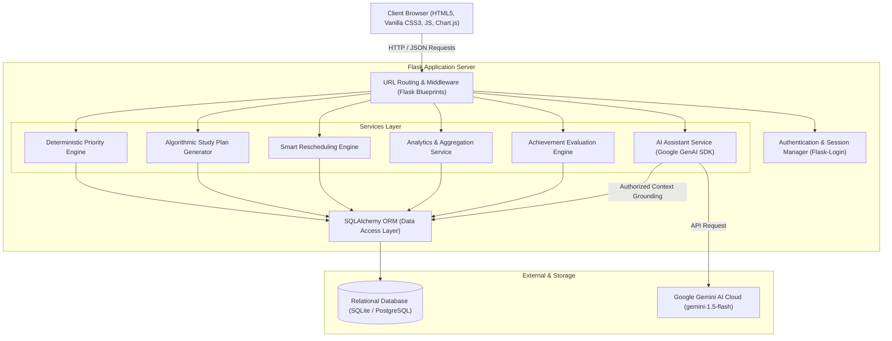
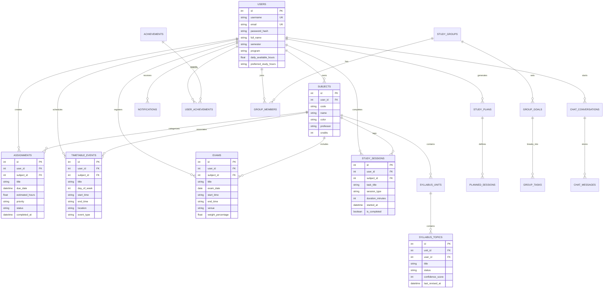

# StudySync — Capstone Technical Project Documentation

**Project Title:** StudySync — Smart Academic Companion with AI Study Assistant  
**Target Domain:** Educational Technology / Full-Stack Web Application  
**Target Audience:** Undergraduate Computer Science & Engineering Students  
**Academic Level:** Bachelor of Engineering (B.E. CSE), Capstone Submission  

---

## 1. Abstract

Undergraduate engineering students frequently struggle with managing multiple academic commitments, including semester examination schedules, laboratory assignments, recurring timetables, and comprehensive syllabus coverage. Traditional productivity applications (e.g., generic calendars, static to-do lists, and disjointed note-taking tools) lack contextual academic awareness, fail to evaluate task urgency in relation to approaching examination dates, and cannot dynamically adapt to missed study sessions.

**StudySync** is a full-stack academic companion web application built to solve these challenges. StudySync provides a unified dashboard integrating assignment tracking, timetable scheduling, syllabus progress tracking, a deterministic priority recommendation engine, an automated conflict-free study plan generator, an intelligent rescheduling engine for missed sessions, Pomodoro focus tracking, empirical analytics with CSV export, and collaborative peer study circles. Furthermore, StudySync integrates a contextual AI Study Assistant powered by the Google Gemini API using the official `google-genai` SDK, offering grounded academic explanations and automated fallback mechanisms when cloud connectivity is unavailable.

---

## 2. Problem Statement

Modern university students face specific challenges in academic time management:
1. **Dispersed Tools:** Students juggle multiple non-integrated tools (spreadsheets for marks, paper notes for syllabus, generic calendar apps for lectures, instant messaging for study groups), leading to missed deadlines and fragmented focus.
2. **Lack of Dynamic Academic Prioritization:** Conventional to-do applications rank tasks solely by manual priority or static due dates. They do not calculate how close an examination is, what percentage of the syllabus remains incomplete, or how much effort a topic requires.
3. **Rigid Scheduling and Planner Fatigue:** When a student misses a planned study session, standard planners either fail to reschedule the task or overwhelm the student by piling tasks onto an already full day without checking class timetables.
4. **Superficial Gamification & Punitive Streaks:** Many existing platforms utilize punitive streaks that discourage students who take necessary rest days.
5. **AI Disconnection:** Typical chatbot interfaces exist in isolation from student data, requiring tedious manual re-prompting of syllabus contents, exam dates, and available hours.

---

## 3. Project Objectives

- Implement an account-isolated full-stack web application with secure password hashing and session authentication.
- Build a normalized relational database supporting courses, assignments, timetable events, examinations, syllabus units, topics, focus sessions, and collaborative study groups.
- Develop a **Deterministic Priority Engine** that transparently calculates urgency scores based on examination proximity, deadlines, and syllabus revision needs.
- Formulate an **Algorithmic Study Plan Generator** that produces realistic, conflict-free study sessions incorporating cognitive breaks and student availability.
- Design an **Intelligent Rescheduling Engine** capable of detecting missed study blocks and proposing alternative conflict-free slots on subsequent days without overwriting session history.
- Integrate an **AI Study Assistant** using Google Gemini API grounded in the student's authorized course commitments with reliable offline fallbacks.
- Implement an in-browser **Pomodoro Focus Timer** with localStorage state persistence and verified database logging.
- Generate empirical analytics with Chart.js and enable personal data export in CSV format.

---

## 4. Limitations of Existing Systems vs. Proposed StudySync

| Dimension | Generic To-Do Apps (e.g., Todoist, Trello) | University LMS (e.g., Moodle, Canvas) | StudySync (Proposed System) |
| :--- | :--- | :--- | :--- |
| **Academic Context** | None. Treats studying identically to grocery shopping. | Course-centric; passive assignment repository. | Active student-centric companion tailored for semester success. |
| **Priority Ranking** | Static manual priority tags. | Sorted by due date only. | Deterministic scoring combining exam proximity, deadlines, and syllabus mastery. |
| **Planner & Breaks** | Static calendar slots; no break intelligence. | No personal study planning capabilities. | Dynamic slot allocation with automatic 10-minute rest breaks. |
| **Rescheduling** | Manual drag-and-drop; no conflict detection. | Not applicable. | Automated detection of missed sessions with conflict-free slot proposals. |
| **AI Integration** | None or generic ungrounded chat prompts. | None. | Contextually grounded with student exams, deadlines, and weak syllabus topics. |
| **Syllabus Tracking** | Not supported. | Often static PDFs. | Interactive units & topics with 1-5 confidence scoring and revision triggers. |
| **Study Groups** | None or requires third-party tools. | Rigid institutional discussion boards. | Peer study circles with invite codes, shared goals, and checklists. |

---

## 5. Functional & Non-Functional Requirements

### 5.1 Functional Requirements (12 Core Modules)
1. **Student Authentication & Isolated Profiles:** Registration, login, session management, profile customization, daily study capacity, theme toggle, and account deletion.
2. **Smart Dashboard:** Aggregated live database statistics (weekly focus hours, pending tasks, average syllabus completion, exam countdowns, timetable, and priority recommendations).
3. **Assignment Tracker:** CRUD, priority levels, estimated effort, status toggling, overdue alerts, and multi-field filters.
4. **Timetable & Exam Calendar:** Weekly schedule grid (Monday to Sunday) with conflict detection, recurring lectures/labs, and exam countdowns.
5. **Syllabus & Revision Tracker:** Hierarchical subject-unit-topic tracking, self-assessed confidence ratings (1 to 5), and revision flags.
6. **Smart Priority Engine:** Deterministic rule-based scoring module with human-readable rationale for every recommendation.
7. **Personalized Study Plan Generator:** Automated session creation respecting preferred study windows, timetable events, and rest breaks.
8. **Smart Rescheduling Engine:** Missed session detection, alternative conflict-free proposal generation, and audit trail preservation.
9. **Focus Timer:** Pomodoro work/break intervals, task tagging, browser reload resilience, and session completion logging.
10. **Academic Analytics:** Interactive Chart.js graphs for daily actual vs. planned study hours, subject syllabus progress, and CSV data export.
11. **Study Buddy & Groups:** Group creation, invite code generation/joining, shared study goals, and collaborative checklists.
12. **Achievements & Consistency:** Non-punitive milestone badge unlocks based on verifiable database actions.
13. **AI Study Assistant:** Conversational tutor grounded in student commitments with intelligent offline fallback.

### 5.2 Non-Functional Requirements
- **Security:** Passwords hashed with `scrypt` via Werkzeug. CSRF protection on forms. Multi-tenant database isolation.
- **Performance:** Database query optimization with indexed foreign keys; sub-100ms response times for core dashboard queries.
- **Reliability:** Graceful degradation when external services (e.g. Gemini API) are unreachable or quota-limited.
- **Accessibility & UX:** High-contrast Dark Navy theme, responsive layout, clear form labels, and mobile navigation drawer.

---

## 6. System Architecture

---

## 7. Database Entity-Relationship (ER) Diagram

---

## 8. Priority Engine Mathematical Model

The Priority Engine produces a deterministic priority score $S \in [0, 165]$ for each candidate task:

$$S_{\text{total}} = S_{\text{exam}} + S_{\text{deadline}} + W_{\text{priority}} + S_{\text{revision}} + S_{\text{status}}$$

### 8.1 Component Formulations
1. **Exam Proximity Score ($S_{\text{exam}}$):**
   $$S_{\text{exam}} = \begin{cases} 
   50 & \text{if } \Delta t_{\text{exam}} \le 3 \text{ days} \\ 
   35 & \text{if } 3 < \Delta t_{\text{exam}} \le 7 \text{ days} \\ 
   20 & \text{if } 7 < \Delta t_{\text{exam}} \le 14 \text{ days} \\ 
   0 & \text{otherwise} 
   \end{cases}$$

2. **Deadline Urgency Score ($S_{\text{deadline}}$):**
   $$S_{\text{deadline}} = \begin{cases} 
   45 & \text{if overdue} \\ 
   40 & \text{if } \Delta t_{\text{due}} \le 24 \text{ hours} \\ 
   30 & \text{if } 1 < \Delta t_{\text{due}} \le 3 \text{ days} \\ 
   15 & \text{if } 3 < \Delta t_{\text{due}} \le 7 \text{ days} \\ 
   5 & \text{otherwise} 
   \end{cases}$$

3. **User Priority Weight ($W_{\text{priority}}$):**
   - High: $+30 \text{ points}$
   - Medium: $+20 \text{ points}$
   - Low: $+10 \text{ points}$

4. **Syllabus Revision Need ($S_{\text{revision}}$):**
   - Flagged `Needs Revision`: $+30 \text{ points}$
   - Confidence Score $\le 2/5$: $+25 \text{ points}$
   - Not revised in $> 14 \text{ days}$: $+15 \text{ points}$

5. **Priority Classification:**
   - **High Priority Tier:** $S_{\text{total}} \ge 70$
   - **Medium Priority Tier:** $40 \le S_{\text{total}} < 70$
   - **Low Priority Tier:** $S_{\text{total}} < 40$

---

## 9. Automated Test Verification Results

StudySync includes 24 automated unit and integration tests executing in isolated environments using `pytest`:

| Test Module | Test Case | Feature Tested | Result |
| :--- | :--- | :--- | :--- |
| `test_auth.py` | `test_registration` | Student account creation with validation | **PASSED** |
| `test_auth.py` | `test_registration_duplicate_username` | Unique constraint protection | **PASSED** |
| `test_auth.py` | `test_login_and_logout` | Session cookie authentication cycle | **PASSED** |
| `test_auth.py` | `test_login_invalid_credentials` | Safe rejection of wrong password | **PASSED** |
| `test_auth.py` | `test_unauthorized_access_protection` | Login redirection on protected routes | **PASSED** |
| `test_assignments.py` | `test_assignment_crud` | Assignment lifecycle, completion timestamps & deletion | **PASSED** |
| `test_timetable.py` | `test_timetable_and_conflict_detection` | Schedule overlap detection on matching weekdays | **PASSED** |
| `test_timetable.py` | `test_exam_creation_and_countdown` | Exam scheduling and countdown calculations | **PASSED** |
| `test_timetable.py` | `test_exams_page_view` | Dedicated examination dashboard view rendering | **PASSED** |
| `test_syllabus.py` | `test_syllabus_progress_calculation` | Weighted unit and subject progress calculations | **PASSED** |
| `test_syllabus.py` | `test_topic_revision_status_update` | Revision state toggle and confidence rating | **PASSED** |
| `test_priority_engine.py` | `test_priority_engine_ranking` | Deterministic score formula and sorting | **PASSED** |
| `test_planner_and_reschedule.py` | `test_planner_engine_generation` | Daily plan slotting with 10m rest breaks | **PASSED** |
| `test_planner_and_reschedule.py` | `test_rescheduler_engine` | Missed session detection and conflict-free rescheduling | **PASSED** |
| `test_groups.py` | `test_study_group_creation_and_joining` | Invite code joining & admin/member roles | **PASSED** |
| `test_groups.py` | `test_unauthorized_group_access` | Access barrier for non-group members | **PASSED** |
| `test_achievements.py` | `test_real_achievement_unlock_and_no_duplicates` | Milestone badge unlock without duplicate awards | **PASSED** |
| `test_ai_fallback.py` | `test_ai_fallback_when_api_key_missing` | Graceful fallback to offline intelligence engine | **PASSED** |
| `test_ai_fallback.py` | `test_ai_student_context_grounding` | Safe academic context gathering without credential leaks | **PASSED** |
| `test_ai_fallback.py` | `test_ai_chat_route_offline_mode` | AI endpoint execution without external cloud key | **PASSED** |
| `test_ai_fallback.py` | `test_ai_conversation_creation_and_history` | Persistent chat thread state & history storage | **PASSED** |
| `test_ai_fallback.py` | `test_ai_conversation_rename_and_delete` | Chat conversation management operations | **PASSED** |
| `test_ai_fallback.py` | `test_ai_conversation_privacy_isolation` | Multi-user isolation of private AI chat logs | **PASSED** |
| `test_data_isolation.py` | `test_user_data_isolation` | Complete multi-tenant privacy barrier between users | **PASSED** |

**Summary:** 24/24 Tests Passed (100% Success Rate).

---

## 10. Conclusion & Future Enhancements

StudySync demonstrates a functional, production-ready full-stack software engineering project solving real student productivity challenges.

### Planned Future Extensions:
1. **Multi-Calendar Sync:** Export timetable and exams directly to `.ics` format for Google Calendar and Apple Calendar.
2. **Audio Study Flashcards:** Voice-assisted quiz mode leveraging Web Audio API.
3. **Automated LMS Scraping:** Secure OAuth sync with Canvas / Moodle assignment calendars.
4. **Offline PWA Support:** Service Worker caching for complete offline functionality on mobile devices.
